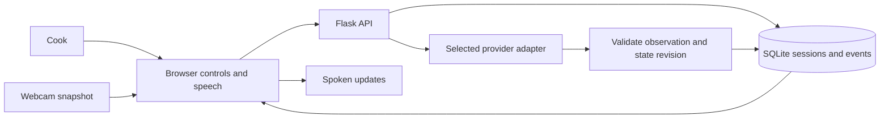

# Architecture and cooking state

## Decisions

Flask serves Jinja HTML and a small JSON API. Plain browser JavaScript owns webcam capture, optional browser speech, and UI rendering. SQLite is sufficient for one local cook and makes sessions/events inspectable without another service. Recipe JSON under `recipes/` supplies all instructions, ingredients and visual cues; scrambled eggs is only the first example. These choices prioritize fast iteration.

Model adapters share a normalized observation contract; the app's state machine, rather than a model, controls step advancement. See [API contract](api.md) for the precise boundary and [provider setup](providers.md) for configuration.

## Data flow

## Human control and concurrency

Each step has instructions and visual completion cues. Two consecutive model observations at confidence >=0.85 may advance one step, but confidence is a heuristic. Manual navigation/correction changes a revision counter; a model response from an older revision cannot overwrite the cook's action.

Each session saves a recipe snapshot. Config edits apply to new sessions; ongoing sessions continue with their original instructions, cues and step count. Existing databases gain the snapshot column through an additive migration. See [structured recipes](recipes.md).

Only one model request per session runs at once. Network calls happen outside SQLite transactions; state is checked again before applying the result. This MVP uses one server process and one active browser tab. A distributed worker/multi-user system would require a different concurrency mechanism.

The Docker image uses one Gunicorn worker with four threads, so manual controls can be served during model calls while the per-process monitoring lock remains valid. The app runs as a non-root user and keeps SQLite and its signing secret in a named volume. See [Docker setup](docker.md).

Mode changes and pauses reset completion evidence. Reloading or restarting pauses monitoring until the user resumes. Final completion always requires the cook's confirmation. Timers have absolute deadlines and are independent of recipe advancement; ending a session cancels its timer.

## Privacy and failure behavior

No frame or audio persistence. SQLite retains normalized observations and action/correction events. Provider failures are sanitized before displaying/logging; manual actions and timers remain available. Camera permission and optional speech can fail without preventing manual use.

See [plan](../PLAN.md), [validation evidence](validation.md), and [agent handoffs](../agents/communications.md).
