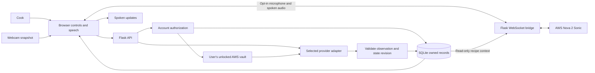

# Architecture and cooking state

## Decisions

Flask serves Jinja HTML and a JSON API. Plain JavaScript owns webcam capture, optional speech and rendering. V2 targets a few trusted accounts on one private instance; SQLite stores revocable logins and account-owned cooking state/preferences. Bundled recipe JSON remains shared, with a database library for personal and additional global recipes. These choices prioritize iteration and a reusable API for a future client.

Model adapters share a normalized observation contract; the app's state machine, rather than a model, controls step advancement. See [V2 contracts](v2-api.md), the [core cooking API](api.md) and [provider setup](providers.md).

| Module | Boundary |
|---|---|
| accounts.py | Password hashes, revocable login sessions, provisioning and authorization |
| app.py | HTTP orchestration, cooking state/revisions and credential-guarded result commits |
| settings.py | Per-account passphrase-encrypted AWS vault and in-memory credential leases |
| library.py / recipes.py | Personal/global catalog, validated recipe data and scaling drafts |
| recipe_ai.py / providers.py | Bounded AI drafts and provider request/observation normalization |
| cooking.py | Owned timers, checklists, history notes, advisory alerts and freshness |
| voice.py | Authorized duplex stream and read-only fresh cooking context |
| static/app.js / static/v2.js | Core cooking/media lifecycle and account/library/tool views |

## Data flow

## Human control and concurrency

Each step has instructions and visual completion cues. Two consecutive model observations at confidence >=0.85 may advance one step, but confidence is a heuristic. Manual navigation/correction changes a revision counter; a model response from an older revision cannot overwrite the cook's action.

Each session saves a recipe snapshot. Config edits apply to new sessions; ongoing sessions continue with their original instructions, cues and step count. Existing databases gain the snapshot column through an additive migration. See [structured recipes](recipes.md).

Only one model request per cooking session runs at once. Network calls happen outside SQLite transactions; login, ownership, revision and credential validity are checked again before applying the result. A database constraint enforces one active cook per user. One server process retains in-memory vaults and bounded stream limits; distributed workers require a different synchronization/key lifecycle design.

The Docker image uses one Gunicorn worker with eight threads, so manual controls can be served during model calls and a voice WebSocket while per-process locks remain valid. Voice is capped at one active stream and two authenticating sockets. The app runs as a non-root user and keeps SQLite and its signing secret in a named volume. See [Docker setup](docker.md).

Mode changes and pauses reset completion evidence. Reloading or restarting pauses monitoring until the user resumes. Final completion always requires the cook's confirmation. Timers have absolute deadlines and are independent of recipe advancement; ending a session cancels its live timers. Obstructed views and safety concerns cannot qualify for automatic progression. See [cooking tools](cooking-tools.md).

## Privacy and failure behavior

The [voice companion](voice.md) is a separate duplex stream from visual monitoring. The server supplies recipe context and recent evidence; voice never writes cooking state. Microphone capture is explicit and stops on navigation, hidden tabs, end, lock or disconnect. Audio and conversational transcripts remain ephemeral. The existing encrypted AWS connection supplies a static credential snapshot; the stream must also check that connection remains unlocked and unchanged.

No frame or audio persistence. SQLite retains normalized observations and action/correction events. Provider failures are sanitized before displaying/logging; manual actions and timers remain available. Camera permission and optional speech can fail without preventing manual use.

See [plan](../PLAN.md), [validation evidence](validation.md), and [agent handoffs](../agents/communications.md).
